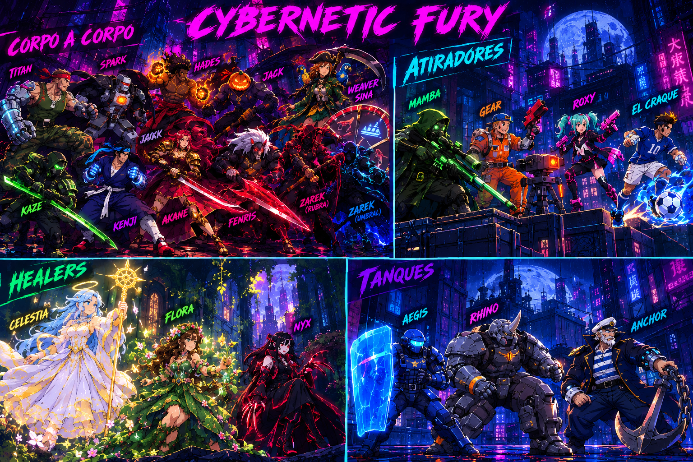

<div align="center">

# ⚡ CYBERNETIC FURY ⚡

**Briga de rua cyberpunk vista de cima, com 21 lutadores, 4 arenas cheias de perigo e partidas de 1v1 até 3v3.**



### 🎮 [JOGAR AGORA NO NAVEGADOR](https://marcusneves0.github.io/CyberFury/) 🎮


*HTML, CSS e JavaScript puro, sem engine: só Canvas 2D e Tone.js para os sons.*

</div>

---

## 🌆 O jogo

Neo-Cidade está tomada por neon, chuva e gente disposta a brigar por qualquer motivo. **Cybernetic Fury** é uma arena de luta com câmera de cima, no estilo Brawl Stars: você anda em 8 direções, a mira é automática e cada lutador tem um golpe, um golpe forte, uma defesa e uma **ultimate** própria.

- 🥊 **1v1, 2v2 ou 3v3:** contra a IA ou **P1 vs P2** no mesmo computador
- 🎮 **Teclado ou controle:** suporte a controle de PS5/Xbox, inclusive para navegar nos menus
- 💚 **Healer obrigatório:** no 2v2 e no 3v3, todo time tem pelo menos um curandeiro
- 🗺️ **4 arenas** com perigos próprios, escolhidas no menu ou sorteadas a cada luta
- 📊 **Estatísticas no fim da luta:** dano causado, dano sofrido, cura, abates e o ⭐ destaque da partida
- 🎨 **Pixel art em 64×64**, com animações de andar, atacar, soltar a ultimate, cair e comemorar

---

## 👊 Os lutadores

### Lutadores corpo a corpo
| | Lutador | Estilo | Ultimate |
|---|---|---|---|
| 🦾 | **Titan** | Ex-soldado com braço robótico | Soco-foguete com onda de choque |
| 🔥 | **Hades** | Punhos de fogo, queima quem acerta | Círculo de fogo que explode no chão |
| 🎃 | **Jack** | Amaldiçoado no Halloween, rouba vida | Abóbora amaldiçoada |
| 🗡️ | **Kaze** | Espadachim, cortes que fazem sangrar | Tornado que prende o inimigo no ar |
| ✨ | **Kenji** | Combo de socos que acelera a cada acerto | Investida explosiva |
| 🌸 | **Akane** | Lâmina carmesim que cura a cada golpe | *Dança das Sete Lâminas*: 7 cortes seguidos |
| 🐺 | **Fenris** | Fera sombria | Salta e dispara lâminas do céu |
| 🩸 | **Zarek** | Muda de forma no meio da luta: **Rubra** 🔴 ou **Umbral** 🔵 | Entra no corpo do inimigo e sai rasgando |
| 🕷️ | **Weaver** | Acrobata com teia e sentido aranha | Puxão de teia e chute para cima |
| 🏴‍☠️ | **Capitã Sina** | Pirata apostadora de faca; o papagaio revela quem se esconde nos arbustos | *Roleta da Sina*: 🔫 pistola, 🦈 tubarão ou o raro 🌊 barco de água |
| ⚡ | **Spark** | Robô de segurança abandonado | Corrente elétrica que dobra de dano |

### Atiradores
| | Lutador | Estilo | Ultimate |
|---|---|---|---|
| 🧪 | **Mamba** | Rifle tóxico de longo alcance | Nuvem de veneno |
| 🔧 | **Gear** | Mecânico de pregos | Monta até 3 torretas |
| 💗 | **Roxy** | Duas pistolas, a adrenalina acelera os tiros | Frenesi: cada pistola escolhe um alvo |
| ⚽ | **El Craque** | Atacante que chuta bolas que voltam | Chama todas as bolas de volta |

### Healers
| | Lutador | Estilo | Ultimate |
|---|---|---|---|
| ✨ | **Celestia** | Aura de cura em volta dela | Círculo de cura gigante para o time |
| 🌺 | **Flora** | Flores que voam até o aliado ferido | Flor encantada de cura |
| 🌙 | **Nyx** | Rouba vida batendo e manda para o time | Laço de vida com o inimigo |

### Tanques
| | Lutador | Estilo | Ultimate |
|---|---|---|---|
| 🛡️ | **Aegis** | 1600 de vida, o escudo segura os tiros do time | Muralha de energia |
| 🦏 | **Rhino** | Ganha embalo correndo | Estouro: atropela tudo, quebra caixas e torretas |
| ⚓ | **Anchor** | Não sai do lugar com empurrões | Gancho: a corrente arrasta ele até o inimigo e o atordoa |

> Passe o mouse sobre cada lutador na tela de seleção para ler a história dele.

---

## 🗺️ As arenas

| Arena | Clima | Perigos |
|---|---|---|
| 🌃 **Praça Neon** | Rua cyberpunk com poças refletindo o neon | Árvores e caixas de papelão que quebram |
| 🌧️ **Telhado Neon** | Chuva, relâmpagos e a cidade lá embaixo | **Letreiros em curto** dão choque em quem está na poça embaixo deles |
| 🧪 **Laboratório Abandonado** | Luzes piscando, gosma verde, portas quebradas | **Laser de segurança** varrendo a sala, **fios soltos** soltando faíscas e **tanques de vidro** que liberam gás |
| 🌸 **Jardim Suspenso** | Flores que se mexem quando alguém passa, pétalas e vaga-lumes | **Arbustos** que escondem, **plantas carnívoras** que mordem e **flores de cura** |

---

## 🕹️ Controles

| Ação | Contra a IA | P1 | P2 | Controle |
|---|---|---|---|---|
| Andar | WASD ou setas | WASD | Setas | Analógico / D-pad |
| Soco (segure para o soco forte) | J | F | K | □ / X |
| Ultimate | K | G | L | △ / Y ou R1 |
| Defesa | L | H | Ç | ◯ / B ou L1 |

Nos menus, com o controle: **✕ confirma** e **◯ volta**.

---

## 🚀 Rodando no seu computador

O jogo é só HTML, CSS e JS, então basta servir a pasta:

```bash
git clone https://github.com/marcusneves0/CyberFury.git
cd CyberFury
python -m http.server 8123
```

Depois abra **http://localhost:8123** no navegador.

---

## 📝 Sobre o projeto

- Começou como um jogo para **aprender HTML, CSS e JavaScript** e testar a criação de um jogo do zero.
- Feito em **colaboração com IA** (Gemini e Claude) em todas as partes: mecânicas, personagens, arte e código. O balanceamento é testado com milhares de lutas simuladas entre IAs.
- Todos os lutadores são **originais**: os que começaram inspirados em personagens de outros jogos ganharam nome, história e identidade próprios.
- Recebe **atualizações regularmente**. Antes era "sempre que o código não quebrava" 😅, mas agora cada mudança passa por testes e lutas simuladas antes de subir.

<div align="center">

**Obrigado por ler, tmj! 🤘**

</div>
